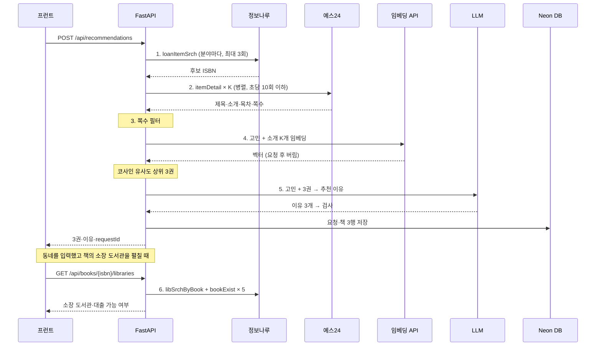
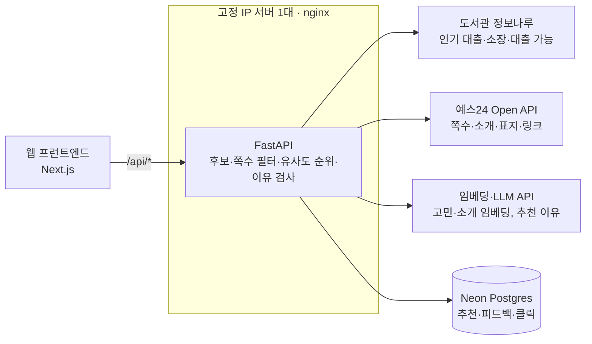

# 설계 문서

## 개요

연령·분야(최대 3개)·분량·고민을 입력받아 정보나루 인기 대출 도서 중 고민에 맞는 N권을 고르고, 추천 이유·소장 도서관·구매 링크와 함께 보여주는 서비스

| 항목 | 결정 |
| --- | --- |
| 추천 도서 | N권(3권). 후보는 정보나루 인기 대출 목록 |
| 순위 | 고민과 책 소개의 임베딩 유사도로 3권을 고르고, LLM은 추천 이유만 생성 |

## 서비스 흐름

| 입력 | 필수 | 값 |
| --- | --- | --- |
| 연령 | 필수 | 20대 / 30대 / 40대 / 50대 / 60세 이상(정보나루 연령 코드) |
| 분야 | 필수 | KDC 대분류, 최대 3개 |
| 분량 | 필수 | 200쪽 이하 / 201\~350쪽 / 351쪽 이상 / 상관없음 |
| 고민 | 필수 | 자유 입력 |
| 동네 | 선택 | 시군구 |

**화면 상태**

| 상황 | 화면 |
| --- | --- |
| 정상 | 상위 N권을 먼저 보여주고, 동네를 입력한 경우 책마다 소장 도서관과 대출 가능 여부를 표시('어제 기준') |
| 결과가 N권 미만 | 있는 만큼 보여주고, 넓힐 조건과 추가 권수를 제안 |
| 동네 미입력 / 소장처 없음 | "내 주변 도서관 확인" 안내로 유도 |
| LLM 장애 | • 고른 3권은 그대로, 이유는 템플릿 문장.&#32; |
| 외부 도서 API 장애 | • 예스24: 정보를 못 받은 책은 빼고 추천.&#32;<br>• 정보나루: 추천 불가 안내, 소장 안내는 '일시적으로 확인 불가' |
| 임베딩 장애 | 대출순 3권과 템플릿 이유, 고민이 반영되지 않았음을 알림 |

## 도서 추천 흐름

요청마다 아래 6단계를 거친다. 임베딩 API와 LLM을 각각 1회 부르고, 결과는 DB에 저장한다.


장애 시: 임베딩 → 대출순 3권 · LLM → 템플릿 이유 · 예스24 → 못 받은 책 제외

| 단계 | 하는 일 | 사용 |
| --- | --- | --- |
| 1. 후보 조회 | 분야마다 1회(최대 3회) 연령별 최근 1년 인기 대출을 받아, 아동·학습참고서와 같은 책의 다른 권을 빼고 상위 K권(초기: 30권) | 정보나루 `loanItemSrch` |
| 2. 책 정보 | K권 병렬 조회(초당 10회 이하, 429면 1회 재시도) | 예스24 `itemDetail` |
| 3. 쪽수 필터 | 구간 밖 제외. 쪽수가 없으면 '상관없음'일 때만 남김 | — |
| 4. 순위 | 고민과 후보(제목·소개·목차 앞부분)를 한 번에 임베딩해 코사인 유사도 상위 3권. 벡터는 요청이 끝나면 버림. 장애면 대출순 3권 | 임베딩 API |
| 5. 추천 이유 | 고민과 3권 정보로 책마다 이유 생성 후 검사(입력에 없는 고유명사·숫자면 템플릿). 장애면 템플릿 이유 | LLM |
| 6. 소장 도서관 | 동네를 입력했고 사용자가 책의 소장 도서관을 펼칠 때, 소장 도서관 최대 5곳과 각 도서관의 대출 가능 여부 | 정보나루 `libSrchByBook`·`bookExist` |

- 후보는 인기 대출 목록에서만 나와, 목록 밖의 책은 추천하지 못한다
- 가장 느린 단계는 예스24 조회(30권이면 최소 3초). 메모리 캐시는 첫 주 실측 후 정한다
- 방식 비교와 채택 이유는 부록 탭

## 아키텍처



- 고정 IP 서버 1대: 정보나루 하루 500건을 넘기려면 서버 IP 등록이 필요하다
- 캐시·벡터 저장 등 확장 계획은 부록 탭

## 데이터 모델

추천 결과, 피드백, 링크 클릭을 Neon에 저장한다.

| 테이블 | 한 행 | 컬럼 |
| --- | --- | --- |
| `recommendation_request` | 추천 요청 | `request_id`(PK), `created_at`, `age_group`, `kdc`(text\[\], 1\~3개), `page_range`, `concern`(90일 후 null), `has_region`, `selection`(`embedding`/`loan_order`), `embedding_model`, `llm_model`, `result_count`, `latency_ms`, `degraded`(text\[\]) |
| `recommendation_item` | 보여준 책 | PK(`request_id`, `rank`), `isbn`, `score`(유사도, 대출순이면 null), `reason`(LLM 이유는 90일 후 null), `reason_type`(`llm`/`template`) |
| `recommendation_feedback` | 책 1권 피드백 | PK·FK(`request_id`, `isbn`), `vote`(`up`/`down`), `created_at` |
| `recommendation_click` | 링크 클릭 | `click_id`(PK), FK(`request_id`, `isbn`), `target`(`buy`/`library`), `created_at` |

- **저장 시점**: 결과를 만든 뒤 요청·책 행을 한 트랜잭션으로 쓰고 응답한다. DB 쓰기가 실패해도 추천은 돌려준다
- **피드백·클릭**: 피드백은 책당 1회(이미 있으면 409, 수정·취소 없음). 클릭은 누를 때마다 기록하고, `requestId`로 피드백과 묶어 보려고 GA4가 아닌 DB에 둔다
- **저장하지 않음**: 동네, IP, 사용자 식별자

## 기술 스택

| 영역 | 선택 |
| --- | --- |
| 프런트엔드 | Next.js(React, TypeScript) |
| 백엔드 | Python 3.12, FastAPI, httpx, SQLAlchemy 2(async)+asyncpg, Alembic, pytest, uv |
| API 계약 | FastAPI OpenAPI(`openapi.json`) → openapi-typescript로 프런트 타입 생성 |
| DB | Neon(Postgres) |
| 임베딩·LLM | 한국어 성능이 검증된 상용 API(팀 결정). 유사도 계산은 메모리에서(numpy) |
| 배포 | 고정 IP 서버 1대, Docker Compose(nginx, web, api) |
| 외부 데이터 | 정보나루·예스24 Open API(Open API 탭) |

## 프로젝트 구조

저장소 2개(이름은 예시). 계층이 아니라 기능 단위로 묶어, 에이전트에게 폴더 하나를 맡기고 그 폴더의 테스트로 확인한다. API 계약의 기준은 백엔드 OpenAPI다.

**백엔드** (`bookok-api`, FastAPI)

```text
bookok-api/
├─ CLAUDE.md                # 실행·테스트 명령, 의존 규칙, 금지 사항
├─ app/
│  ├─ main.py               # 기능 라우터 3개 등록
│  ├─ core/                 # 설정, DB 세션, 공통 오류 응답
│  │  └─ schema.py          # CamelModel: API 스키마 공통 베이스(camelCase 변환)
│  ├─ integrations/         # 외부 API(기능 간 공유)
│  │  ├─ data4library/      # client.py, fixtures/, test_client.py
│  │  ├─ yes24/             # 초당 10회 제한을 여기서 한 번만
│  │  └─ llm/               # 임베딩·채팅 클라이언트
│  └─ features/
│     ├─ recommendations/   # POST /api/recommendations
│     │  ├─ router.py, schemas.py
│     │  ├─ service.py      # 1~6단계 연결, 장애 시 대체
│     │  ├─ candidates.py   # 1 후보 조회
│     │  ├─ books.py        # 2~3 책 정보·쪽수 필터
│     │  ├─ rank.py         # 4 임베딩 유사도 3권
│     │  ├─ explain.py      # 5 추천 이유 생성·검사
│     │  ├─ repository.py, models.py
│     │  └─ tests/          # 단위 테스트 + eval/(평가 세트)
│     ├─ libraries/         # GET /api/books/{isbn}/libraries
│     │  ├─ router.py, schemas.py, service.py
│     │  └─ tests/
│     └─ engagement/        # POST /api/feedback, POST /api/clicks
│        ├─ router.py, schemas.py, service.py, repository.py, models.py
│        └─ tests/
├─ jobs/purge.py           # 90일 삭제(매일)
├─ migrations/             # Alembic
├─ deploy/                 # docker-compose.yml, nginx.conf
├─ openapi.json            # 생성물
└─ pyproject.toml          # uv
```

**프런트엔드** (`book-reco-web`, Next.js): 같은 기능 단위로 `features/`(recommend-form, results, libraries, engagement)와 `shared/`(API 클라이언트, OpenAPI 생성 타입)를 둔다.

- **의존 방향**: `features → integrations, core`만 허용하고 기능끼리는 import하지 않는다. `engagement`는 `recommendation_item`을 테이블 이름으로만 FK 연결한다
- **기능 단위 작업**: 테스트와 샘플 응답(`fixtures/`)은 코드 옆에 둔다. `pytest app/features/engagement`처럼 폴더 단위로 확인하고, 외부 API 없이 돌아간다
- **교체 지점**: `rank(concern, books, n) → picks`와 `explain(concern, picks) → reasons` 경계를 지키면 순위 방식을 바꿔도 다른 파일은 그대로다
- **배포**: nginx가 `/api/*`는 FastAPI로, 나머지는 `next start`로 넘긴다(같은 도메인이라 CORS 불필요)

## 팀이 결정할 내용

| 항목 | 선택지·초안 | 시점 |
| --- | --- | --- |
| 임베딩·LLM 모델, 요청당 비용 상한 | 벤더별 비교(한국어 성능) | 개발 전 |
| 임베딩 입력 범위 | 제목+소개 / +목차 앞부분, 길이 상한 | 개발 전 |
| 고민 길이 상한 | — | 개발 전 |
| 소개가 없는 책 | 제외 / 제목만 임베딩 | 개발 전 |
| 인기 대출 조회 기간 | 최근 1년(초안) / 3년 / 전체 | 개발 전 |
| 분야 여러 개 조회 | 분야별 호출 후 합침(확정, 역할분담 탭) | 구현 첫 주 |
| 메모리 캐시 | 첫 주 응답 시간 실측 후 | 구현 중 |
| NLK 쪽수 보완 | 예스24 쪽수 빈 비율 실측 후 | 구현 중 |
| 지연 목표 | — | 구현 중 |
| 고민 보관 동의 | 안내 문구만 / 별도 동의 체크(법무 검토) | 출시 전 |

## 운영·검증

- **호출 한도**: 예스24 초당 10회 이하, 429면 1회 재시도. 정보나루는 고정 IP 등록(아키텍처)
- **장애 판단**: 외부 도서 API 3초, 임베딩·LLM 10초 무응답·오류면 1회 재시도 후 장애(화면은 화면 상태 표)
- **개인정보**: 고민 원문·LLM 이유는 DB에 90일 보관 후 매일 삭제 작업이 지우고, 로그에는 남기지 않는다. 고민 입력란 아래에 외부 처리(임베딩·LLM)와 90일 보관을 안내한다. DB 접근은 서비스 계정과 지정 분석 담당자만, 임베딩·LLM API는 입력을 학습·보관하지 않는 조건만 쓴다

**수용 기준**

| 기능 | 수용 기준 |
| --- | --- |
| 입력 검증 | 연령·분량·분야·고민 중 하나라도 비면 요청 불가, 분야는 최대 3개 |
| 추천 결과 | 조건 위반 책 0권, N권(부족하면 화면 상태대로), 책마다 예스24 링크·출처 표기 |
| 고민 반영 | 책마다 고민과 연결된 이유, 책 정보에 없는 내용 0건 |
| 개인정보 | 로그에 고민 원문 없음, 90일 지난 고민·LLM 이유는 DB에서 지워짐 |
| 피드백·클릭 | 피드백 책당 1회, 클릭은 기록이 실패해도 이동을 막지 않음 |

**평가 세트**: 고민 예시 20\~30개(주제·연령·분야·분량 조합)로 순위 품질(유사도 상위 3권 적합도, 사서 등이 3단계 채점)과 이유 품질(책 정보에 없는 내용 0건)을 따로 재고, 조건 위반 0건과 지연을 확인한다.
